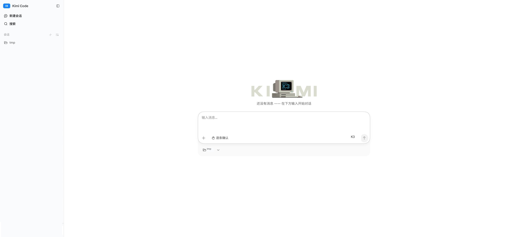

# 在网页中使用

Kimi Code Web 是 Kimi Code CLI 内置的浏览器图形界面：在终端运行 `kimi web`，就能在浏览器里新建会话、对话、处理审批、查看文件改动——界面更易读，会话和数据仍全部保存在你的本机。



## 开始使用

<div class="step">
<span class="step-num">1</span> <strong>安装并登录 Kimi Code CLI</strong>

`kimi web` 是 CLI 的内置命令，未安装 CLI 时不可用。安装与登录见 [开始使用](./getting-started.md)。
</div>

<div class="step">
<span class="step-num">2</span> <strong>在终端运行 <code>kimi web</code></strong>

如果你已经在 CLI 里，也可以输入 `/web`，把当前会话交接到浏览器。
</div>

<div class="step">
<span class="step-num">3</span> <strong>服务就绪后自动用默认浏览器打开 Web 界面</strong>

启动横幅会打印访问地址，浏览器没有自动打开时，手动复制这行地址打开即可：

```text
  Local:    http://127.0.0.1:58627/#token=...
  Network:  off  use --host to enable
  Token:    ...
  Logs:     off  use --log-level info to enable
  Stop:     Ctrl+C
```

::: warning 注意
地址里的 `#token=` 是访问凭证，请勿外发。停止服务在终端按 `Ctrl+C`：在 macOS 与 Linux 上，进程会打印停止过程、最迟 12 秒内结束，并以退出码 `130` 退出（退出码即程序结束时返回的状态数字，`0` 表示成功）。`kill`（SIGTERM）行为相同，只是退出码为 `143`。详见[信号与重载](#信号与重载)。
:::
</div>

### 常用指令

| 选项 | 说明 |
| --- | --- |
| `--port <port>` | 绑定端口；内置默认 `58627`，被占用时自动 +1 重试；未传该 flag 时由 `config.toml` 的 `[server] port` 决定 |
| `--host [host]` | 实现同一局域网下的手机、平板或其他电脑都能用 web 地址访问，也可指定 IP，如 `--host 192.168.1.10` |
| `--ipv6` | 绑定全部网卡时，让横幅一并列出 IPv6 网卡地址；默认关闭——它只改变横幅打印的内容，不改变实际绑定 |
| `--no-open` | 就绪后不自动打开浏览器 |
| `--log-level <level>` | 按所选级别开启服务日志；默认不输出 |

上表的每个选项都在 `config.toml` 的 `[server]` 节里有对应键，偏好的绑定方式可以存下来而不必每次重敲；优先级为 `CLI flag` > `[server]` > 内置默认值。详见 [`server` 节](../configuration/config-files.md#server)。

### 信号与重载

`Ctrl+C`（SIGINT）与 `kill`（SIGTERM）停止服务的方式相同：终端会打印 `Shutting down (SIGINT)…`（或 `SIGTERM`），进程关闭自己的 socket 与连接，并以该信号自己的退出码结束——SIGINT 为 `130`，SIGTERM 为 `143`。等待是有上限的：若清理在 12 秒内没有完成，进程会在 stderr 说明情况并以同样的退出码强制退出。此时再收到任意一个信号，进程不再等待，立即结束。

`SIGHUP` 就地重新加载 `config.toml`，不会重启服务。终端只打印一行改了什么（`config reloaded: providers, thinking`，或 `config reloaded: no changes`）；文件写坏时打印错误，服务沿用改动前的值继续运行，且在文件改对之前不会再写入配置。保存文件本身稍后就会触发热重载，因此刚保存完就发出的重载通常报告 `no changes`——`SIGHUP` 的价值在于这一句明确确认，外加一行 `restart required for: <keys>`：命令会先把本次启动用到的同一组命令行 flag 重新叠加到文件之上，再列出与运行中取值仍然不同的 `[server]` 键。被 flag 固定的键不会出现在这一行，因为重启也不会改变它。十三个 `[server]` 键都只在启动时读取：绑定地址、端口、日志级别和各鉴权开关在 socket 绑定时即已确定，服务运行期间无法更改。

以上为 macOS 与 Linux 的行为：Windows 不会投递 SIGTERM，其 SIGHUP 含义是「控制台正在关闭」——进程约 10 秒后无论如何都会被终止。完整的信号约定见 [kimi 命令：信号与停止](../reference/kimi-command.md#信号与停止)。

## 与 CLI 的关系

Web 界面和 CLI 共享同一份登录态、配置（`config.toml`，含存放 `kimi web` 默认值的 `[server]` 节）和会话数据。

Web 里的斜杠命令与 CLI 不完全一致，支持常用指令 `/new`、`/goal`、`/compact`，部分 CLI 指令在 Web 里有对应的图形入口（设置页、模型选择器、账户菜单、任务面板）。

两端能力对照如下：

<div class="feature-compare-table">

| 功能 | CLI | Web | 说明 |
| --- | --- | --- | --- |
| 流式对话 | ✓ | ✓ | Web 为富格式增量渲染（表格、代码高亮、diff、工具卡片） |
| 会话管理 | ✓ | ✓ | Web 可把不常用的会话归档收起，在已归档页按时间排序、随时恢复；Open / Done / Workspaces 标签页为 Lab 实验特性，默认关闭，需在设置的 Lab 页开启 |
| 审批处理 | ✓ | ✓ | Web 可在图形页面中点击处理，无需指令 |
| 后台任务 | ✓ | ✓ | Web 为任务面板实时展示进度 |
| 文件与改动 | ✓ | ✓ | Web 有改动文件摘要卡与逐文件 diff |
| 设置 | ✓ | ✓ | Web 另有图形化设置页（供应商、账号与用量、Lab 实验特性） |
| 全局搜索 | — | ✓ | Web 可实现跨会话、跨工作区搜索 |
| 移动端适配 | — | ✓ | `--host` 开启局域网共享后，可实现在同一局域网下的手机浏览器中使用；横幅会列出可用的 IPv4 地址 |

</div>

## 安全注意

- **建议设置并列凭证**：绑定局域网地址后，额外设置 `KIMI_CODE_PASSWORD` 环境变量，服务端会对鉴权失败自动限流。
- **不要彻底关闭鉴权**：`--dangerous-bypass-auth` 会关闭所有鉴权，任何能访问该端口的人都能控制你的会话、文件系统和 shell。仅在可信网络或自有鉴权代理之后使用，详见 [kimi 命令参考](../reference/kimi-command.md#kimi-web)。


## 常见问题

### 端口被占用了怎么办

不用处理。`kimi web` 会自动用下一个端口重试（58628、58629……），以启动横幅里实际打印的地址为准。

### 浏览器打不开地址

先确认终端里的服务还在运行（它前台挂在这个终端上）。地址必须完整复制，包含 `#token=` 部分；只输 `http://127.0.0.1:58627` 会停在输入 token 的页面，手动粘贴横幅里的 `Token` 值也可以进入。

### token 失效了怎么恢复

运行 `kimi web rotate-token` 生成新 token，然后用启动横幅里的新地址重新打开。所有运行中的实例会自动换用新 token，无需重启。

### 同一 WiFi 下其他设备访问不到

确认启动时带了 `--host`（裸写即可），并用横幅中局域网地址（形如 `http://192.168.x.x:58627/#token=...`）访问。裸写的 `--host` 只以 IPv4 绑定所有网卡，因此横幅里的 `Network:` 行是 IPv4 地址；想让横幅一并列出 IPv6 地址就带上 `--ipv6`（或设置 `[server] ipv6 = true`）——它只增加提示，不会改变实际绑定的内容。仍不通时检查电脑防火墙是否放行了该端口，以及两台设备是否真的在同一网段（访客 WiFi、VPN、4G/5G 热点切换都会造成隔离）。

## 下一步

- [服务 API](../reference/server-api.md) — 面向脚本与第三方集成的 REST / WebSocket 接口（实验性）
- [kimi 命令](../reference/kimi-command.md#kimi-web) — `kimi web` 的全部命令行选项
